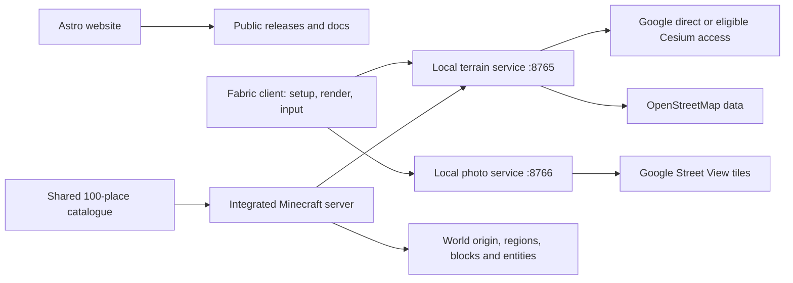

# RealWorldMC handoff

Updated 2026-10-11. This describes the 1.0.0 source snapshot. A source push is separate from a downloadable release.

## Project locations

- **Mod:** `D:\RealWorldMC`, branch `main`, origin `https://github.com/Teddy563/realworldmc.git`.
- **Website:** `D:\RealWorldMC-SITE`, separate Astro project intended for `Teddy563/realworldmc-site`.
- **Installed personal profile:** `D:\ModrinthApp\profiles\RealWorldMC-1.0.0-mc1.21.1`.
- The working copy at `work/RealWorldMC` is build staging, not the canonical GitHub checkout.
- The published source begins with one 1.0.0 initial snapshot. Earlier local Git history is backed up outside this repository. Source publication does not create a release tag or downloadable release.

## What it does

| Feature | Fabric 1.21.1 | Experimental 26.2 |
|---|---|---|
| Real World preset and 3D terrain exploration | Yes, Java 21 | Yes, Java 25 |
| 100 random new-world starts | Shared catalogue | Shared catalogue |
| Standalone Windows x64 JAR with private Node runtime | Yes | Yes |
| First-run masked key setup, `/earth setup` | Yes | Manual configuration |
| Native Street View, blocks, mobs and excavations | Yes, approximate photo projection | Browser viewer only |
| Native camera toggle | F5 | Native Minecraft camera |

The display name is **RealWorldMC**, author **Teddy563**, version **1.0.0**. The visible world type is **Real World**. `/earth` is the promoted command; stable also accepts `/rw`.

New worlds select one of [100 curated destinations](docs/spawn-locations.md), including the Palace of Parliament. Selection is uniform and the coordinate pair is serialized with the generator. Reloads and deaths never reroll the world. Fixed custom starts remain supported.

## Architecture

The website reads public GitHub releases. It never receives API keys or renders live map tiles. The mod talks to local services, which use the player's own provider credentials.

| Directory/file | Responsibility |
|---|---|
| `shared/src/main/java/dev/realworldmc/SpawnLocations.java` | Immutable common spawn catalogue and selection |
| `mod/` | Java 21 / Minecraft 1.21.1 Fabric target |
| `mod-26.2/` | Separate Java 25 experimental target |
| `mod/src/main/java/dev/realworldmc/RealWorldMC.java` | Commands, travel and region synchronization |
| `EarthChunkGenerator`, `EarthRegions`, `Geo` | Collision chunks, saved geographic regions and coordinate transforms |
| `PanoramaRoom`, `PanoramaPlaces`, `StreetEdits` | Photo stops, travel handshake, return state and persistent damage |
| `RWMessages`, `TravelLoading` | Styled chat and loading feedback |
| `SetupCredentials`, `ServiceRuntime`, `BundledService` | Local credentials, automatic service lifecycle and runtime extraction |
| `mod/src/client/java/dev/realworldmc/client/` | Map/photo renderers, setup UI, input, HUD and compatibility |
| `MapRenderer`, `MapTile`, `TileData` | Coarse-to-fine streamed 3D scenery |
| `PanoramaRenderer`, `PhotoEditsRenderer`, `PhotoTerrainMask` | Photo projection, visible edits and hidden collision surfaces |
| Client mixins | Native camera, photo-only Iris pipeline and terrain masking |
| `service/src/server.mjs` | Terrain HTTP endpoints |
| `service/src/provider.mjs`, `tiles.mjs`, `select.mjs` | Provider sessions, glTF/Draco data and LOD selection |
| `service/src/voxel.mjs`, `geo.mjs`, `osm.mjs` | Voxel collision, coordinates and water data |
| `service/src/streetview-server.mjs`, `streetview-native.mjs`, `streetview-navigation.mjs` | Photos, panorama assembly and connected navigation |
| `modpack/`, `build-pack.ps1` | Core, visual and experimental pack generation |
| `mod/src/checks/`, `mod/src/gametest/`, `mod/src/clientcheck/`, `service/test/` | Logic, Minecraft, render and service checks |

## In-game design

- Green **RW**, dark-gray separator, white body text and vanilla light-yellow commands. Clickable help suggests commands without executing them.
- Travel uses a green boss bar with named stages. Photo loading uses the action bar. Avoid repetitive chat status lines.
- F5 is the normal Minecraft perspective binding in both modes. The custom X binding and `/earth camera 1/2/3` are removed. The user's live profile successfully cycled all three perspectives after correcting the keybinding confusion.
- Street View: W toward a selected yellow arrow or arrow keys to travel; V toggles a 3×3 walking square; F7 sources; F8 photo report; `/earth back` returns.
- Untouched collision terrain is hidden under the panorama. Player blocks and excavated surfaces render with Minecraft textures and depth shading. Edits and entities remain at their geographic positions across photo travel.
- Photo worlds use midday light and the vanilla Iris pipeline. Normal Earth shader settings remain available. Distant Horizons is suppressed for Earth/photo scenery to avoid competing LODs.

## Boundaries and saved data

- Photos have no measured wall depth or building interiors. Nearby walking and third person approximate ground projection. Real 3D tile collision is also an approximation.
- Coverage, permissions, network latency and provider quotas affect loading. Do not silently generate fake successful Earth terrain or hide authentication failures.
- New random starts are a curated list, not a verified availability guarantee at every coordinate. Do not probe 100 billable locations at each launch.
- Preserve saved `earthcraft:*` registry names and the loader compatibility alias. Renaming saved namespaces would break worlds; current code packages and display branding use RealWorldMC.
- Credentials belong in local service configuration, never Git, browser code, screenshots, logs or release assets.
- Runtime extraction must preserve credentials on upgrades. Restart/reload only services owned by the mod.
- The personal profile has extra flight/physics mods. They are not part of the public Core pack, and there is no confirmed reason to remove them merely because a camera issue was reported.

## Build and release

Use Java 21 for `mod`, Java 25 for `mod-26.2`, and Node 24 for service tooling. From the corresponding module, run `gradlew.bat build`. Stable also has `gradlew.bat runGameTest`. Both `check` tasks include `spawnLocationChecks`.

The stable regression checks cover all 100 random choices, coordinate pairs, fixed overrides, old configuration migration and serialized-origin reloads. Automated checks do not replace visual gameplay testing.

From the repository root, `build-release.ps1 -MinecraftVersion 1.21.1` (or `26.2`) prepares the standalone JAR, packs, full ZIP and checksums. `prepare-service.ps1`, `bundle-jar.ps1` and `test-pack.ps1` handle the private Node runtime and portable install checks.

Locally prepared bundles are in `release-output/standalone-ready` and `release-output/standalone-experimental`. Check timestamps and the current validation note before using them. Root-level JARs/packs may be older. Build output is not publication.

`.github/workflows/release.yml` builds both versions and checks services/pack extraction on pushes and pull requests. A matching `vVERSION` tag publishes only after both matrix jobs pass. It assembles a draft release, uploads complete assets, then publishes it. No map keys are needed in CI.

## Reading and remaining captures

- [README](README.md), [documentation index](docs/README.md), [setup](docs/setup.md), [keys and costs](docs/accounts-and-costs.md), [controls](docs/controls.md), [limitations](docs/limitations.md).
- [Release process](docs/releases.md), [release checklist](RELEASE-CHECKLIST.md), [experimental port](PORT-26.2.md).
- [Apache 2.0](LICENSE), [NOTICE](NOTICE), [licensing notes](docs/legal/README.md), [code of conduct](CODE_OF_CONDUCT.md). Retain applicable third-party notices.
- [Media checklist](docs/media.md) and [recording plan](docs/recording-plan.md). The README uses one static grid, with Golden Gate at bottom-right, rather than a GIF.
- Still capture: empty setup UI, masked successful key test, Real World creation, native Street View navigation, matching crater before/after, and F5 in flight/photo modes. Keep keys private and provider attribution readable.

## Latest local validation

2026-10-11: both Minecraft builds and shared spawn-selection checks passed. All 10 stable GameTests passed, including saved-origin round trips and configuration migration. Both standalone JAR checks and clean pack-import checks passed without provider requests. The personal 1.21.1 profile was updated while Minecraft was closed and `randomSpawn` was enabled. No saved worlds or API keys were changed.

Installed JAR SHA256: `3757822d695d8022d79558394bbb7f006a1fd84aefc7eb29d12c01faebec12ca`.

The 100 candidate coordinates have not all been live-validated against paid provider imagery. New-world in-game visual testing remains useful. No GitHub release has been published.

## Local commit identity

Use Teddy563 <real@teddy.bar> for new local project commits. Do not append automated co-author trailers or generated-by authorship labels. Keep the initial snapshot as the root of the published history; local history backups stay outside the repository. The repository-local Git settings use this identity; this does not configure cryptographic signing.
