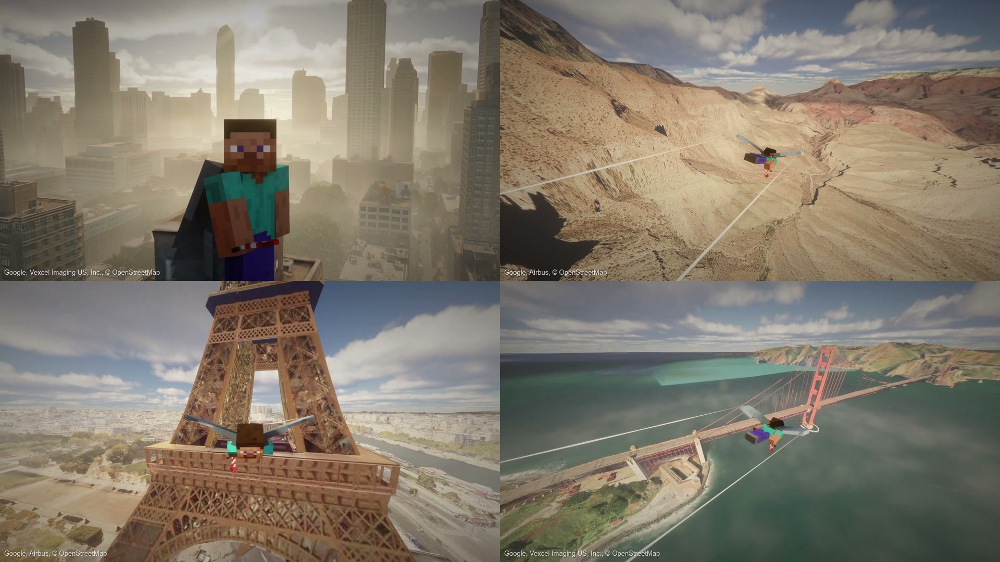

# RealWorldMC

Explore real cities, fly over mountains and step into Google Maps Street View inside Minecraft Java. RealWorldMC brings Google Earth-style scenery into the game, with Minecraft blocks and mobs alongside street-level photos.

[Download](https://github.com/Teddy563/realworldmc/releases/latest) · [Website](https://realworldmc.com/) · [Setup guide](docs/setup.md) · [API keys and costs](docs/accounts-and-costs.md)

[Watch the flight preview](docs/assets/flight-preview.mp4)

## What you can do

- Fly over real-world 3D scenery and travel to places by name or coordinates.
- Use [glide or upright flight](docs/flight.md) without wearing an elytra.
- Explore Street View, follow its arrows, place blocks and spawn mobs.
- Start each new world at one of [100 locations](docs/spawn-locations.md), including the Palace of Parliament in Bucharest.
- Try [experimental space flight](docs/space-flight.md), including Earth orbit and Moon or Mars flyovers. Moon and Mars do not have walkable surfaces.

**Recommended: Minecraft Java 1.21.1 with Fabric and Java 21.** Other Minecraft builds are experimental and have fewer features. See the [setup guide](docs/setup.md) for compatibility.

## Get started

1. Download the **1.21.1 `.mrpack`** from [Releases](https://github.com/Teddy563/realworldmc/releases/latest) and import it into Modrinth App or Prism Launcher. Already have a Fabric profile? Install the matching release **JAR** and [Fabric API](https://modrinth.com/mod/fabric-api) instead.
2. Launch Minecraft. The **RealWorldMC setup** screen opens on first launch.
3. Choose Google or Cesium, enter your own credentials and test the connection. Add a Google Map Tiles API key for in-game Street View. [Follow the account setup steps](docs/accounts-and-costs.md).
4. Select **Save & finish**. The mod starts its local map services automatically.
5. Create a Creative world with commands enabled and choose **Real World** as the world type. Wait for the scenery to load, then explore.

Windows x64 releases include the service runtime. macOS and Linux need Node.js 22+; full gameplay testing on those platforms is still pending. Bedrock, mobile, Forge and NeoForge are not supported.

## Useful controls

| Command | Action |
|---|---|
| `/earth help` | Show commands |
| `/earth setup` | Change or test your keys |
| `/earth glide` / `/earth fly` | Toggle glide or upright flight |
| `/earth goto 44.427454, 26.087287` | Visit the Palace of Parliament |
| `/earth streetview` | Enter the nearest Street View photo |
| `/earth back` | Return from Street View |

**F5** changes the camera. In Street View, look toward a yellow arrow and tap **W** to travel. **V** toggles a small walking area. See [all controls](docs/controls.md).

## Before you play

- Internet access and your own provider credentials are required. **Map usage can cost money.** Read [limits and billing](docs/accounts-and-costs.md) before adding keys.
- Coverage varies. Blocks approximate the scenery, and Street View photos do not provide building interiors or accurate wall depth.
- Shader and add-on compatibility varies. Check [known limitations](docs/limitations.md) and [troubleshooting](docs/troubleshooting.md).
- When updating, back up your worlds, close Minecraft and replace the old JAR. Keep only one copy of RealWorldMC installed.

## Documentation

[All guides](docs/README.md) · [Recording guide](docs/media.md) · [Architecture](HANDOFF.md) · [Build instructions](docs/releases.md) · [Changelog](CHANGELOG.md)

## Credits and licence

Earth data comes from Google and OpenStreetMap, with Cesium available for 3D map access. Moon and Mars have separate [imagery credits](docs/planetary-data.md). Keep provider attribution visible when sharing captures.

Code: [Apache License 2.0](LICENSE). Map and imagery assets have their own terms. Not affiliated with Mojang, Microsoft, Google or Cesium.

[NOTICE](NOTICE) · [Licensing notes](docs/legal/README.md) · [Code of conduct](CODE_OF_CONDUCT.md)
